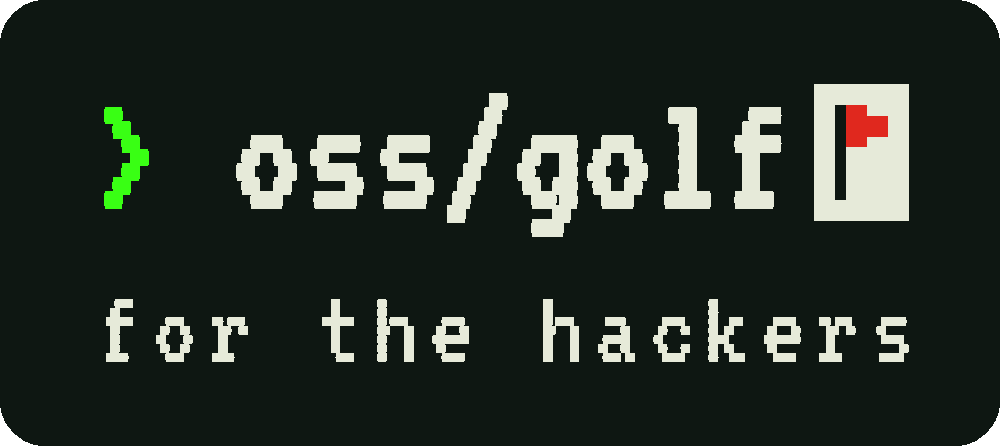

<p align="center">
  
</p>

# ossgolfweb

The OSSGolf website, live at [ossgolf.com](https://ossgolf.com). A static blog
for the open source golf projects, built with
[RSS Lobster](https://github.com/HectorZarate/rsslobster). Zero JavaScript output
except a tiny inline search, no trackers, no external requests.

Live projects it points to:

- [osstempo](https://github.com/OSSGolf/osstempo). ESP32 LED golf tempo trainer (firmware, web client, build docs).
- [osstempo-ios](https://github.com/OSSGolf/osstempo-ios). Native SwiftUI and CoreBluetooth iOS controller.
- [unofficial-r10-ios-sdk](https://github.com/OSSGolf/unofficial-r10-ios-sdk). Swift SDK for the Garmin R10 launch monitor.

## How it works

- `rsslobster.json` is the site config (title, tagline, style preset).
- `posts.json` is the content source of record for every post.
- `_site/` is the built output. Cloudflare serves this directory (build root `/_site`).
- Post images live in `_site/images/` and are referenced as `/images/<name>.png`.

## Logo and graphics

- `custom.css` holds the site's style overrides, including the `> oss/golf` header.
- `logo/` holds the wordmark and the round avatar, as SVG and PNG. `python3 graphics/logo.py`
  regenerates them, plus the social preview image at `_site/og-image.png`.
- `python3 graphics/build.py` regenerates the Open Source Golf Landscape map from
  `graphics/landscape.json`.

Both scripts need macOS with Chrome; the logo script also needs `fonttools` and `brotli`.

## Local preview

```
rsslobster dev
```

## Add a post

```
rsslobster publish "$(cat body.md)" --type post --title "Title" --slug my-slug --tags "a,b,c"
./build.sh
```

`./build.sh` runs `rsslobster regenerate .`, then `python3 graphics/postbuild.py` and
`python3 graphics/logo.py`. RSS Lobster regenerates every page, the preview image and the
favicons with its defaults, so the first script re-applies the shared header (GitHub link, and
the tagline on post pages) and the second puts the oss/golf images back.

Commit the updated `posts.json` and `_site/`, then push. If the git-connected
Cloudflare build does not pick it up, deploy the built assets directly:

```
wrangler deploy
```

`wrangler.toml` deploys `_site/` to the `ossgolfweb` Worker (assets only).

Licensed under [MIT](LICENSE).
